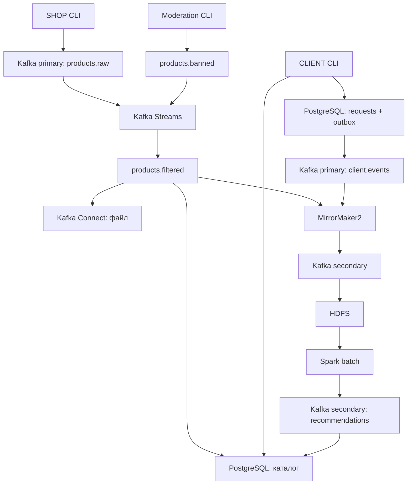

# «Покупай выгодно» — финальный проект по Kafka

Магазины загружают товары, Kafka Streams убирает запрещённые, а клиент ищет товары и получает рекомендации. Данные дублируются во второй Kafka-кластер, сохраняются в HDFS и обрабатываются Spark. Всё поднимается локально через Docker Compose. Аккаунт в облаке и платные сервисы не нужны.

## Быстрый запуск

Нужны Git, Docker Engine с Compose v2 (или Docker Desktop), Bash и доступ к Docker Hub/Maven/PyPI. На Windows команды выполняются в WSL2. Рекомендуется **16 ГБ RAM, 6 CPU и 25 ГБ свободного диска**, выделенных Docker. Здесь шесть JVM брокеров и несколько систем обработки; на маленьком ноутбуке запуск будет медленным. Проверки рассчитаны на чистый стенд.

```bash
git clone https://github.com/SVFr13nD/kafka-final-project.git
cd kafka-final-project
bash scripts/start.sh
bash scripts/demo.sh
bash scripts/verify.sh
```

Первый запуск скачивает образы и собирает приложения. `start.sh` генерирует сертификаты, поднимает оба кластера, создаёт топики и ACL, затем запускает обработчики. Дождитесь строки `Ready`.

`demo.sh` блокирует p006, отправляет шесть товаров и действия двух пользователей. В каталоге остаются пять товаров. У Alice первые рекомендации — часы и наушники, у Bob — кофемолка и чайник. Скрипт не подставляет готовые ответы: он ждёт данные в PostgreSQL, проверяет зеркало и HDFS, запускает настоящий Spark job и читает результат из Kafka.

`verify.sh` проверяет репликацию, запрет чужой записи, обязательный клиентский сертификат, позднюю блокировку и разблокировку товара. Затем останавливает `primary-3`, ждёт доставленного уведомления Alertmanager, отправляет товары при двух работающих брокерах и возвращает брокер. В конце должно появиться `ALL INTEGRATION CHECKS PASSED`. Не запускайте эту проверку на чужом/рабочем кластере — она предназначена только для данного Compose-стенда.

Остановить сервисы, сохранив данные:

```bash
bash scripts/stop.sh
```

Для **полного удаления тестовых данных**: `docker compose down -v`. После этого повторите три команды запуска. Сертификаты остаются в `.runtime`; не удаляйте их отдельно от Kafka volumes. Секреты генерируются локально и исключены из Git.

## Что открыть

| Сервис | Адрес | Доступ |
|---|---|---|
| Grafana | http://localhost:3000/d/marketplace-kafka | `admin` / `marketplace-demo` |
| Prometheus | http://localhost:9090 | локальный стенд |
| Alertmanager | http://localhost:9093 | локальный стенд |
| HDFS NameNode | http://localhost:9870 | вкладка Browse Directory |
| Kafka Connect | http://localhost:8083/connectors | REST API |
| Список запретов | http://localhost:8090/bans | просмотр состояния фильтра |

Порты опубликованы только на `127.0.0.1`. Kafka доступна приложениям внутри Docker-сети, её порты на хост не проброшены. Пароли PostgreSQL/Grafana и пароль контейнеров PKCS12 — учебные, не для внешнего размещения.

## Команды магазина и клиента

```bash
# Загрузка версионируемого файла data/products.jsonl
docker compose run --rm shop

# Поиск по части имени, без учёта регистра
docker compose run --rm client services.cli search 'часы' --user alice

# Действия клиента: view, cart, purchase, review
docker compose run --rm client services.cli event cart p001 --user alice

# Пересчёт рекомендаций по накопленным данным в HDFS
docker compose run --rm analytics

# Получить рекомендации
docker compose run --rm client services.cli recommend --user alice

# Управление запретами
docker compose run --rm moderator services.cli ban add p001
docker compose run --rm moderator services.cli bans
docker compose run --rm moderator services.cli ban remove p001
```

Доставка асинхронная: изменение запрета и запрос клиента не мгновенно оказываются во всех системах. `demo.sh` использует ожидания с ограниченным таймаутом, а не произвольные паузы. В ручном режиме перед Spark дождитесь `hdfs_saved` в `docker compose logs lake` и опустошения outbox. Примеры и ожидаемые результаты — в [examples/walkthrough.md](examples/walkthrough.md).

## Архитектура



Оба кластера — по три Kafka 3.9.1 в режиме KRaft, без ZooKeeper. Каждый узел совмещает broker/controller. У прикладных топиков три партиции, replication factor 3, `min.insync.replicas=2`, продюсеры используют `acks=all` и идемпотентность. Один недоступный брокер не должен остановить запись; два недоступных узла приводят к потере большинства KRaft, поэтому этот стенд не обещает доступность при двух отказах.

| Компонент | Версия / роль |
|---|---|
| Apache Kafka, Streams, Connect, MirrorMaker2 | 3.9.1 |
| Python / confluent-kafka | 3.11 / 2.8.2; CLI, outbox, sink-процессы |
| Java | 17; фильтр Kafka Streams |
| PostgreSQL | 16.8; поиск, запросы, outbox, рекомендации |
| Apache Hadoop | 3.4.1; NameNode + DataNode |
| Apache Spark | 3.5.5; пакетная аналитика HDFS |
| JMX Exporter | 1.0.1 |
| Prometheus / Alertmanager / Grafana | 3.2.1 / 0.28.1 / 11.6.0 |

### Защита и топики

Все Kafka listeners, включая межброкерный трафик и контроллеры, используют TLS с проверкой имени сервера. Клиенты аутентифицируются сертификатами (mTLS), CN преобразуется в principal. Каждый контейнер получает только свой ключ и общий CA. Только admin и сами брокеры являются super users. `allow.everyone.if.no.acl.found=false`.

SHOP может писать только `products.raw`; модератор — `products.banned`; клиентский outbox — `client.events`. Kafka Streams читает raw/bans, пишет filtered/invalid и свои внутренние топики. MirrorMaker2 имеет права на исходные данные и свои служебные/целевые топики. Остальные потребители ограничены своими топиками и группами. Полный список разрешений — [services/bootstrap.py](services/bootstrap.py). Негативный тест выполняется именно с сертификатом магазина, не администратора.

| Кластер | Топик | Политика | Назначение |
|---|---|---|---|
| primary | products.raw | delete | исходные товары |
| primary | products.banned | compact | последнее состояние запрета по product_id |
| primary | products.filtered | compact | разрешённые товары, tombstone при запрете |
| primary | products.invalid | delete | некорректные сообщения |
| primary | client.events | delete | поиски, рекомендации и действия клиентов |
| secondary | primary.products.filtered | compact | зеркало разрешённого каталога |
| secondary | primary.client.events | delete | зеркало событий |
| secondary | recommendations | compact | последний результат по user_id |

Retention для delete-топиков — сутки, сегмент — 100 МиБ. У compact-топиков `delete.retention.ms=86400000`: tombstone хранится минимум сутки для отстающих потребителей. После более длительного простоя/потери состояния нужно пересоздать производные хранилища из актуального снимка, а не считать старую БД актуальной. Служебные топики Connect и MM2 также реплицируются; `connect-configs` имеет одну партицию по требованию Connect.

### Фильтрация и хранение

Kafka Streams строит две KTable: товары и запреты. Join реагирует на обе стороны. Первичная блокировка не выпускает товар в каталог; поздняя блокировка выпускает tombstone; снятие запрета возвращает последний товар. Включён `exactly_once_v2`, downstream-потребители читают `read_committed`. Тесты топологии покрывают эти переходы и некорректные данные.

PostgreSQL хранит актуальный каталог. Обработчик сохраняет Kafka offset вместе с изменением в одной транзакции и подтверждает Kafka после commit. Отдельная таблица offsets сохраняется и после удаления товара: повтор старого сообщения не воскрешает удалённую запись. Поиск использует параметризованный SQL.

Запросы CLIENT сначала атомарно записываются в `client_requests` и `outbox`. Отдельный процесс отправляет outbox в Kafka. Это исключает потерю события между успешной записью запроса и публикацией. При аварии после Kafka ack, но до DB commit возможен повтор; Spark убирает повторы по `request_id`.

Kafka Connect FileStreamSink пишет только `products.filtered` в `/debug/products.jsonl`. Это **журнал для отладки**, а не текущий каталог: ранее разрешённый товар остаётся в истории после запрета, за ним идёт tombstone. Актуальное состояние смотрите в PostgreSQL. Остановка коннектора может привести к повторным строкам; exactly-once для файла не заявляется.

### Зеркало, HDFS и Spark

MirrorMaker2 копирует только filtered/events с префиксом `primary.`. Исходные запрещённые товары в Data Lake не отправляются. HDFS sink пишет запись по пути `dataset/partition/offset.json`, затем подтверждает offset. Повторная доставка перезаписывает тот же файл. Tombstone тоже сохраняется.

Spark читает HDFS, выбирает последнюю запись каждого товара по offset и исключает tombstones. Для пользователя суммирует интерес к категориям: просмотр = 1, корзина = 3, покупка = 5, отзыв = 2. Затем берёт три товара с наибольшим баллом, при равенстве — по product_id. Это простая объяснимая аналитика, не ML. Результат сохраняется в HDFS и отдельном топике `recommendations` второго кластера. Потребитель обновляет PostgreSQL; CLIENT дополнительно проверяет наличие рекомендованного товара в текущем каталоге.

В проекте выбран **базовый вариант аналитики HDFS + Spark** и **расширенное хранилище PostgreSQL**, плюс обязательный отладочный Kafka Connect sink. ksqlDB и Schema Registry не нужны для этого варианта. Контракт JSON хранится в [schemas/product.json](schemas/product.json).

### Мониторинг

Java agent JMX Exporter подключён к каждому из шести брокеров. Prometheus собирает метрики каждые 5 секунд. Grafana provisioning автоматически создаёт datasource и dashboard: доступность, недореплицированные партиции, сообщения/с, трафик, партиции ниже min ISR, память JVM.

`KafkaBrokerDown` срабатывает через 15 секунд недоступности метрик. Alertmanager действительно делает HTTP POST в `alert-receiver`, который сохраняет уведомления в `evidence/alerts.jsonl`. Проверка ждёт и `firing`, и `resolved`. Telegram не используется, поэтому проверяющему не нужны токены. Недоступность JMX может означать проблему exporter/сети, а не только процесса брокера — это инфраструктурный сигнал.

## Проверки и материалы для сдачи

```bash
# Контракты данных и конфигурация
pip install -r requirements-dev.txt
python -m pytest -q

# Kafka Streams unit tests (JDK 17+, Maven)
mvn -f filter/pom.xml test

# Все интеграционные проверки — после start и demo
bash scripts/verify.sh
```

GitHub Actions выполняет тот же сценарий и прикладывает архив `marketplace-evidence`. Зелёный статус относится к конкретному commit; наличие workflow само по себе не означает успешный прогон.

В `evidence/` после запуска появятся фактические логи: demo, проверки, топология, описания топиков, рекомендации, зеркало и webhook-уведомления. Эти файлы не выдуманы и не зафиксированы заранее. Сделайте скриншоты Grafana, списка контейнеров и вывода `demo.sh`/`verify.sh` на своём стенде. Чек-лист — [evidence/README.md](evidence/README.md).

## Ограничения учебного стенда

Все контейнеры живут на одном Docker-хосте: отказ всего хоста не покрывается репликацией. HDFS использует один DataNode и replication=1; это не production Data Lake. Маленький файл на каждое событие и сбор top-3 всех пользователей на driver подходят только для демонстрационных объёмов. Для промышленной нагрузки нужны партиционированные батчи Parquet, checkpoint/compaction и распределённая публикация результатов.

Роли ограничены по сервисам, но магазины не изолированы друг от друга внутри одного raw-топика. Все вспомогательные REST API и PostgreSQL находятся в доверенной Docker-сети; наружу их публиковать нельзя. CA/ключи и пароли для промышленной среды должны храниться в менеджере секретов, а узлы — разноситься по независимым хостам.

## Если запуск не прошёл

- `docker compose ps -a` и `docker compose logs --tail=100 <сервис>` покажут причину.
- При нехватке памяти увеличьте лимит Docker. Не уменьшайте replication factor ради запуска: это изменит условия проекта.
- Если скачивание образа/зависимостей не удалось, восстановите доступ к registry и повторите `start.sh`.
- Если Kafka пишет об ошибках сертификатов, проверьте системное время и соответствие `.runtime` существующим volumes.
- Если Spark не видит данные, сначала выполните `docker compose run --rm verify data` и проверьте логи `mirror`/`lake`.

Официальные материалы: [Kafka Streams DSL](https://kafka.apache.org/39/streams/developer-guide/dsl-api/), [MirrorMaker2](https://kafka.apache.org/39/operations/geo-replication-cross-cluster-data-mirroring/), [Kafka Connect](https://kafka.apache.org/39/kafka-connect/user-guide/), [WebHDFS](https://hadoop.apache.org/docs/r3.4.1/hadoop-project-dist/hadoop-hdfs/WebHDFS.html), [Spark SQL](https://spark.apache.org/docs/3.5.5/sql-programming-guide.html).
